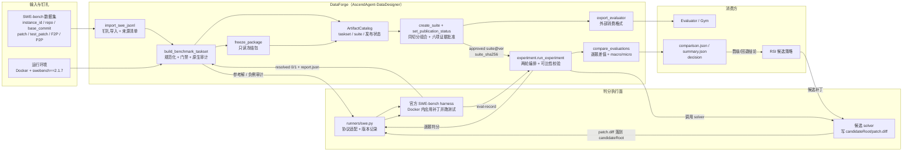
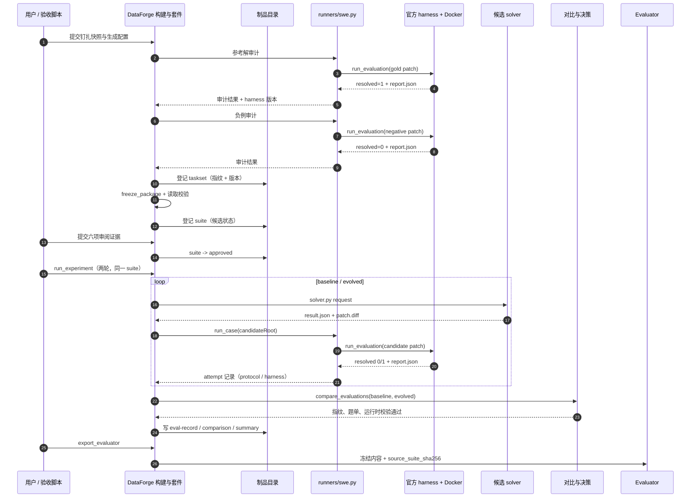

# SWE-bench 官方 resolved 跨轮实验使用指南

本指南说明如何用 DataForge（AscendAgent-DataDesigner）在一份 SWE-bench 类快照上完成
**构建题集 -> 冻结 -> 批准 suite -> 两轮真实候选评测 -> 跨轮对比 -> Evaluator 导出**
的完整链路，并给出跨轮可比性的验收口径。命令以 Linux / WSL2 为例。

## 1. 这条链路验证什么

它回答一个问题：**同一套冻结题集、同一套官方判分协议下，候选策略的轮间分数能否直接比较。**

验收口径（与本仓库 RSI 实验验收一致）：

1. 至少 2 轮实验，引用**同一个 suite 版本**与同一个 `suite_sha256`；
2. 两轮的有序题单完全一致，系统在不一致时直接报错；
3. 判分统一走官方 SWE-bench `resolved` 0/1 协议（`swebench_resolved_0_1`），
   且 `swebench` harness 版本与 runner 版本逐题记录；
4. `infra_failed` / `cancelled` 不计入分数分母，并在对比报告中单独列示；
5. 产出逐题差值与 macro/micro 指标的轮间对比报告；
6. 篡改题单顺序、suite 摘要或 harness 版本时，比较器必须失败。

## 2. 职责边界

| 组件 | 负责 | 不负责 |
|---|---|---|
| DataForge | 快照钉扎导入、题目规范化、门禁、冻结包、suite、两轮编排、跨轮校验、对比报告、Evaluator 导出 | 不实现判分器执行环境 |
| 官方 SWE-bench harness | 在 Docker 内应用候选 `patch.diff`，执行测试并给出 `resolved` | 不管理题集版本与跨轮一致性 |
| RSI / 候选策略 | 产出候选补丁，落到 `patch.diff` | 不读取 gold、不修改 suite、不参与判分 |
| Evaluator / Gym | 消费导出格式做外部评测 | 不改变 suite 摘要与判分策略 |

### 2.1 组件交互总览



图中三条边界：

- **公开面**：候选 solver 只拿到 `publicItem`、空 `workspace` 和 `candidateRoot`；
- **受信面**：数据集行、gold/test patch、trusted manifest、reference/negative 审计目录只在 DataForge 与 verifier 之间流动；
- **判分面**：DataForge 不执行测试，只调用钉扎的 `runners/swe.py`，由官方 harness 在 Docker 内给出 `resolved`。

### 2.2 两轮评测时序



失败路径同样固定：

- 参考解未 `resolved` 或负例被 `resolved`：该题审计失败，构建按 `on_item_rejection` 隔离或中止；
- 两轮 `suite_sha256`、有序题单或 `policy` 不一致：比较器抛 `BenchmarkError`；
- harness/verifier/protocol 版本漂移：比较器抛 `BenchmarkError`；
- 出现 `infra_failed`/`cancelled`：单列且不入分母，实验决策为 `invalid`；
- 导出丢失 suite 摘要或出现 `degraded`：验收脚本直接失败。

## 3. 前置环境

1. Linux 或 WSL2 Ubuntu，Docker 可用（本机验收使用 Docker 29.1.3）；
2. 独立的 SWE-bench harness venv，本机钉扎 `swebench==2.1.7`：

   ```bash
   python -m venv ~/.venvs/swebench217
   ~/.venvs/swebench217/bin/pip install swebench==2.1.7
   ```

3. DataForge 仓库及其 Linux venv（`.venv/bin/python`，Python >= 3.10）；
4. 一份 SWE-bench 格式数据集（`.jsonl` 或 `.json` 列表），每行至少包含：

   ```text
   instance_id, repo, base_commit, problem_statement, patch,
   test_patch, FAIL_TO_PASS, PASS_TO_PASS, created_at, version
   ```

5. 首次运行会拉取 `sweb.base` / `sweb.env` Docker 镜像，耗时明显长于后续运行。

## 4. 快速开始

```bash
export DATA_FORGE_ROOT=/path/to/AscendAgent-DataDesigner
export SWE_BENCH_PYTHON=$HOME/.venvs/swebench217/bin/python
export SWE_BENCH_WORKDIR=$HOME/swe-official/work
export SWE_BENCH_DATASET=$HOME/swe-official/data/lite-dev.jsonl
export SWE_BENCH_WORK=$HOME/swe-official/e2e-run1        # 必须是仓库外的空目录
export SWE_BENCH_INSTANCES=instance-a,instance-b,instance-c,instance-d,instance-e,instance-f

bash "$DATA_FORGE_ROOT/examples/swe_bench_official/ops/swe_bench_e2e.sh"
```

也可以直接调用 DataForge 入口：

```bash
cd "$DATA_FORGE_ROOT"
export RAY_ADDRESS=local
export SWE_BENCH_PYTHON SWE_BENCH_WORKDIR
.venv/bin/python scripts/swe_official_e2e.py \
  --dataset "$SWE_BENCH_DATASET" \
  --work "$SWE_BENCH_WORK" \
  --instances "$SWE_BENCH_INSTANCES" \
  --audit-concurrency 1
```

可选参数：

| 参数 | 默认 | 说明 |
|---|---|---|
| `--max-instances` | 6 | 未指定 `--instances` 时取数据集前 N 条 |
| `--timeout` | 1800 | 单题 harness 超时秒数，同时写入 suite 策略 |
| `--audit-concurrency` | 1 | 参考/负例审计并发数；首次构建环境镜像时必须为 1，否则多个镜像构建会同时抢占 Docker 主机 |
| `--min-sample-size` | 2 | 决策最小配对样本数 |
| `--skip-export` | 关 | 跳过 Evaluator 导出 |

约束：

- `--work` 必须位于 DataForge 仓库之外且为空目录；脚本拒绝复用非空目录。
- 数据集中的 `instance_id` 不得重复；指定 `--instances` 时全部必须存在。
- 至少需要 2 道题，少于 6 道题时决策通常为 `inconclusive`，但链路仍可验证。

## 5. 阶段说明

### 5.1 快照导入与钉扎

脚本把所选行写成 `inputs/snapshot.jsonl`，计算 SHA-256，并以
`benchmark-source-v1` 来源清单登记：来源版本、上游 split、许可记录、
每行实例快照路径与摘要。原始 gold/test patch 只保留在受信侧。

### 5.2 官方 harness 审计

构建期为每道题执行两次官方 harness：

- **参考解审计**：gold patch 必须 `resolved=1`；
- **负例审计**：空修复补丁必须 `resolved=0`。

任一不通过则该题被隔离；本链使用 `on_item_rejection="fail"`，构建直接失败。
审计同时把 harness 版本、runner 版本与协议写入审阅证据。

### 5.3 冻结与 suite

构建产出 `taskset`，按内容寻址冻结成只读包；随后创建单一 split（`development`）的
suite，钉扎 `repeats=1`、`seed=0`、`timeout_seconds` 与 family 权重。
suite 摘要覆盖题集引用、策略与切分，任何一项变化都会改变 `suite_sha256`。

### 5.4 批准

脚本生成六项审阅证据（来源版本、许可、原生环境、参考解、负例、隔离性），
以 `#sha256=` 形式钉扎到审阅记录，再把 suite 置为 `approved`。
评测只能加载已批准且摘要校验通过的 suite。

### 5.5 候选补丁 `patch.diff`

`patch.diff` 是候选相对 `base_commit` 的 unified diff（与 `git diff` 输出同格式），
不是仓库快照、不是 commit，也不是测试报告。它由文件级 diff 和 hunk 组成：

```diff
diff --git a/src/module.py b/src/module.py
--- a/src/module.py
+++ b/src/module.py
@@ -10,7 +10,8 @@ def parse(value):
-    return value.strip()
+    value = value.strip()
+    return value or None
```

harness 的用法是：检出 `repo@base_commit`，应用候选 `patch.diff`，再应用官方
`test_patch`，执行 `FAIL_TO_PASS` / `PASS_TO_PASS`。因此：

- 必须能干净应用到 `base_commit`，上下文行不匹配会失败；
- 只应包含候选的代码修改，不要包含测试补丁（`test_patch` 由官方提供）；
- 支持新增、删除、重命名文本文件；二进制 diff 不在本链路支持范围；
- 本链路限制：普通文件、非符号链接、非空、不超过 2 MB；
- `baseline.py` 写入一个无害的新文件补丁；`evolved.py` 写入外部 RSI 预先产出的补丁；
  验收中的 evolved 使用 gold 派生补丁作为正控制。

`patch.diff`、gold patch、test patch 是三份不同内容：gold patch 用于参考解审计，
test patch 用于官方测试，候选 `patch.diff` 只代表候选策略的修改。

### 5.5 两轮真实候选评测

`run_experiment` 在同一 suite 上执行两轮：

| 轮次 | solver | 行为 |
|---|---|---|
| `baseline` | `examples/swe_bench_official/solvers/baseline.py` | 写入一个不含修复的负例补丁 |
| `evolved` | `examples/swe_bench_official/solvers/evolved.py` | 从 RSI 候选目录读取每题补丁；本演示使用 gold 派生补丁验证链路 |

每次 attempt 都有独立 workspace 与 candidate root；solver 协议为
`python solver.py <request.json> <result.json>`，必须回显 `task_id`、`attempt_index`、
`seed` 与 `solver_version`。每轮结束写出 `eval-record.json`。

> 说明：本链路的 workspace 是空目录，solver 看不到仓库快照。它验证的是
> **判分、冻结与跨轮可比协议**；真实 RSI 需要在自身工具链中检出 `repo@base_commit`
> 后产出补丁，再把补丁交给本链路评测。

### 5.6 跨轮对比与导出

比较器强制校验：

- `suite_sha256` 与 suite 引用一致；
- `tasks` 有序题单一致；
- `repeats` / `seed` / `weights` / `timeout` 等策略一致；
- verifier 版本、harness 版本、判分协议逐题一致。

任一不一致抛出 `BenchmarkError`，不会静默比较。通过后写出 `comparison.json`，
并生成 `summary.json` 与决策。最后可选导出 Evaluator 格式，导出摘要必须携带
同一 `source_suite_sha256`，且 `degraded` 为空。

### 5.7 holdout 晋升（一次性）

development 两轮实验产出 `decision=promote` 后，先登记不可变实验制品，再授权
一次 holdout 终评。holdout 套件必须已批准，且 family/release 谱系与 development
一致：

```bash
dataforge benchmark promote \
  --catalog "$SWE_BENCH_WORK/catalog" \
  --experiment swe-official-experiment@1 \
  --holdout swe-official-holdout-suite@1 \
  --approver release-reviewer \
  --reason "macro delta +0.17, sign-test p=0.03"
```

Python 侧终评必须携带晋升记录；记录只能消费一次，重复使用会报
`holdout promotion has already been consumed`：

```python
record = benchmark.evaluate(
    holdout_handle,
    candidate_root,
    phase="final",
    allow_holdout=True,
    promotion=promotion,
)
```

## 6. 产物地图

```text
$SWE_BENCH_WORK/
  inputs/
    snapshot.jsonl              # 钉扎快照
    instances/<id>.json         # 单实例受信快照
    environment.json            # Docker/harness 运行时
    runtime-registry.json       # verifier 钉扎与启动命令
    source.json / augment.json  # 来源与扩充声明
  candidates/<id>/
    reference/patch.diff        # gold 审计输入
    negative/patch.diff         # 负例审计输入
  trusted/                      # 受信 manifest
  catalog/                      # 制品目录（taskset + suite + 状态）
  package/                      # 冻结只读包
  evidence/                     # 六项审阅证据（运行目录内）
  suite-review.json             # 审阅记录（证据摘要钉扎）
  experiment/
    rounds/baseline/eval-record.json
    rounds/evolved/eval-record.json
    comparison.json
    summary.json
  evaluator/                    # 可选导出
  acceptance-summary.json       # 验收总览（脚本最后写）
  self-verification-report.md   # 人类可读自验证报告（不复制原始 harness 文件）
```

## 7. 判分协议与版本钉扎

| 字段 | 值 |
|---|---|
| 协议 | `swebench_resolved_0_1` |
| runner 版本 | `swebench-v2-native-adapter-v1` |
| harness 版本 | 从 `swebench` 包元数据读取（本机 `2.1.7`） |
| 判分输入 | `<candidateRoot>/patch.diff` |
| 判分输出 | `passed` / `score`（0 或 1）、`FAIL_TO_PASS`、`PASS_TO_PASS` |
| 运行记录 | 官方 run 报告与逐实例报告保留在工作目录，不随仓库分发 |

每个 attempt 记录 `protocol`、`verifier_version`、`harness_version`；
每轮记录在 `runtime.harness_versions` / `runtime.protocols` 中。跨轮比较对三者做严格相等校验。
离线派生的 `swe_offline_patch` 题不得与本链路的官方 resolved 分数混比。

## 8. 结果解读

### 8.1 评测记录

`eval-record.json` 关键字段：

| 字段 | 含义 |
|---|---|
| `suite_sha256` | 本轮实际使用的 suite 摘要 |
| `tasks` | 有序题单 |
| `policy` | `repeats`/`seed`/`weights`/`timeout`/资源上限 |
| `runtime` | verifier/harness/protocol 逐题版本 |
| `metrics` | `macro_pass_rate`、`micro_pass_rate`、`graded_total`、`infra_failed_total`、`cancelled_total` |
| `excluded` | 被排除的 infra/cancelled 题 |

### 8.2 对比报告

`comparison.json` 包含：

- `macro_baseline` / `macro_candidate` / `macro_delta`；
- `micro_baseline` / `micro_candidate` / `micro_delta`；
- `changed_tasks`：逐题 `failed -> passed` / `passed -> failed`；
- `infra_summary`：两轮被排除的题目清单；
- `suite_sha256` 与运行时版本校验结果。

### 8.3 决策

`summary.json.decision.decision` 取值：

| 取值 | 条件 |
|---|---|
| `promote` | 改善题数 > 回退题数且符号检验 `p <= alpha` |
| `keep_incumbent` | 回退显著 |
| `inconclusive` | 样本不足或差异不显著 |
| `inconclusive_small_sample` | 配对题数小于 `min_sample_size` |
| `invalid` | 存在 infra/cancelled 失败，不给晋级结论 |

六题全部由失败变为通过时，符号检验 `p=0.03125`，决策应为 `promote`。

## 9. RSI 接入

RSI 侧最小闭环：

1. 读取上轮 `eval-record.json` 与 `comparison.json`；
2. 为每道题产出候选补丁，写到 `SWE_CANDIDATE_PATCH_DIR/<source_task_id>.diff`；
3. 用同一 suite 引用调用 `run_experiment`，两轮 solver 分别为 incumbent 与 RSI 适配器；
4. 读取 `comparison.json` 与 `summary.json` 做晋级决策。

```python
from data_designer.pipelines.benchmarks.api import load_suite
from data_designer.pipelines.benchmarks.experiment import run_experiment

handle = load_suite(catalog, suite_ref, suite_version)
summary = run_experiment(
    handle.store,
    handle.suite,
    [
        {"id": "incumbent", "solver": "/path/to/incumbent_solver.py"},
        {
            "id": "rsi-round-2",
            "solver": "/path/to/AscendAgent-DataDesigner/examples/swe_bench_official/rsi/solver.py",
            "solver_env": {
                "SWE_CANDIDATE_PATCH_DIR": "/path/to/rsi-round-2-patches",
                "SWE_SOLVER_VERSION": "rsi-policy-2026-11-17",
            },
        },
    ],
    "/path/to/experiment-output",
)
```

可直接复制的适配器见 `examples/swe_bench_official/rsi/solver.py`，接口说明见
`examples/swe_bench_official/rsi/README.md`。

## 10. 常见问题

| 现象 | 原因 | 处理 |
|---|---|---|
| `SWE_BENCH_PYTHON/WORKDIR unavailable` | 环境变量未导出或路径不是文件 | 在同一个 shell 中导出，确认 `python -c "import swebench"` 可用 |
| `work directory is not empty` | 复用了旧输出目录 | 换一个空目录，或确认后清理旧目录 |
| `official SWE-bench harness failed` | Docker 未启动、镜像拉取失败、实例环境不兼容 | 先手工跑一次 `swebench.harness.run_evaluation` 定位 |
| 两个新实例的审计长时间无进展 | 默认并发过高，两个冷环境镜像同时构建，Docker 主机被拖死 | 使用 `--audit-concurrency 1` 串行构建；镜像预热后再提高并发 |
| 构建阶段长时间停在 Ray 连接 | WSL 中存在遗留 Ray 集群，自动连接到已失效的 GCS | 使用隔离实例：`RAY_ADDRESS=local RAY_TMPDIR=/tmp/ray-df` |
| `suite SHA-256 drift` | 手工改过 catalog 中的 suite | 不要原地修改；重新构建并发布新版本 |
| `harness version drift` | 两轮使用了不同的 harness venv | 两轮固定同一个 `SWE_BENCH_PYTHON` |
| `infra_failed > 0` | 超时、环境异常、容器失败 | 修复环境后重跑；infra 题不入分母，决策为 `invalid` |
| `decision=inconclusive_small_sample` | 题目数少于 `min_sample_size` | 增加题目或降低 `--min-sample-size`（仅用于链路验证） |
| 导出的 `degraded` 非空 | suite 策略无法被 Evaluator 完整表达 | 检查导出能力矩阵，修复后重导 |

## 11. 本次验收记录

本轮端到端结果、运行时版本与自验证清单见 [自验证报告](SWE-bench官方resolved跨轮实验_自验证报告.md)。
报告只记录结果与关键摘要，不复制或归档 harness 原始文件；原始报告保留在生成工作目录，路径仅用于现场溯源。

验收日期：2026-11-17。运行环境：WSL2 Ubuntu + Docker 29.1.3，`swebench==2.1.7`。

| 项目 | 值 |
|---|---|
| 数据集 | SWE-bench Lite dev，23 行 |
| 数据集 SHA-256 | `c446a167a6feac6179be2db8c2f144a97d0e1a4fff8495149c2ad89adb9d22e1` |
| 题量 | 6 |
| suite | `swe-bench-official-suite@1` |
| suite SHA-256 | `f2e8c0cbb00b8fb01b9686f39af61665ee8da6fd0bf66f326a2ee5a5bd71e281` |
| taskset | `swe-bench-official@1`，指纹 `sha256:5594d4d836d08801a77a689c3cc477107b04c4f1bf87d100e0d25d954b31e0ed` |
| 冻结包摘要 | `sha256:52d348dae2ed23b87fbc0b3a4a2290081cd430d0da702e96f8c815f917d70b53` |
| runner 版本 | `swebench-v2-native-adapter-v1` |
| harness 版本 | `2.1.7` |
| 判分协议 | `swebench_resolved_0_1` |

实例：

```text
sqlfluff__sqlfluff-1625
sqlfluff__sqlfluff-1733
sqlfluff__sqlfluff-1517
sqlfluff__sqlfluff-1763
sqlfluff__sqlfluff-2419
marshmallow-code__marshmallow-1359
```

两轮结果：

| 轮次 | macro_pass_rate | micro_pass_rate | infra_failed | cancelled |
|---|---|---|---|---|
| baseline | 0.0 | 0.0 | 0 | 0 |
| evolved | 1.0 | 1.0 | 0 | 0 |

对比与决策：

- `macro_delta = 1.0`，`micro_delta = 1.0`；
- 6 道题全部 `failed -> passed`，`changed_tasks` 共 6 条；
- 符号检验 `p = 0.03125 <= alpha = 0.05`，决策 `promote`；
- 负向断言全部通过：篡改有序题单、suite SHA-256、harness 版本均被比较器拒绝；
- Evaluator 导出 `source_suite_sha256` 与 suite 一致，`degraded = []`，`attempts = 1`，`aggregation = micro`。

验收命令（镜像已预热后使用并发 2）：

```bash
cd "$DATA_FORGE_ROOT"
export RAY_ADDRESS=local
export SWE_BENCH_PYTHON=$HOME/.venvs/swebench217/bin/python
export SWE_BENCH_WORKDIR=$HOME/swe-official/work
.venv/bin/python scripts/swe_official_e2e.py   --dataset $HOME/swe-official/data/lite-dev.jsonl   --work $HOME/swe-official/e2e-acceptance-6b   --instances sqlfluff__sqlfluff-1625,sqlfluff__sqlfluff-1733,sqlfluff__sqlfluff-1517,sqlfluff__sqlfluff-1763,sqlfluff__sqlfluff-2419,marshmallow-code__marshmallow-1359   --audit-concurrency 2
```

> 首次运行曾因 `sqlfluff-2419`（0.8）与 `marshmallow-1359`（3.0）的冷环境镜像同时构建而卡住；
> 已把审计并发默认值改为 1，并在镜像预热后再使用 2。该修复已包含在入口脚本中。


## 12. 发布前检查清单

- [ ] 两轮引用同一 `suite_sha256`，且 `tasks` 顺序一致；
- [ ] 每轮 `runtime.protocols` 全为 `swebench_resolved_0_1`；
- [ ] 每轮 `runtime.harness_versions` 与 `SWE_BENCH_PYTHON` 实际版本一致；
- [ ] `infra_failed_total == 0`、`cancelled_total == 0`；
- [ ] `comparison.changed_tasks` 逐题方向符合预期；
- [ ] 篡改题单 / suite 摘要 / harness 版本时比较器报错；
- [ ] `comparison.json` 含逐题差值、按族通过率、macro/micro 与方差；
- [ ] holdout 未被用作扩充来源，也未进入 RSI 训练题单；
- [ ] 导出携带 `source_suite_sha256` 且 `degraded` 为空；
- [ ] 工作目录位于仓库外，未把 `artifacts/` 或 harness 日志提交进仓库。
